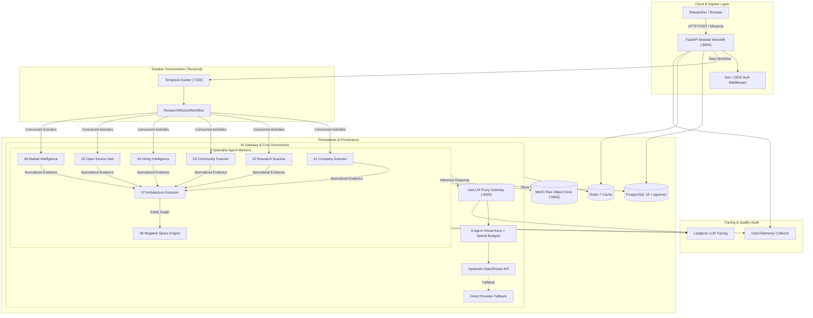

# Formal Architecture & Contract Audit (Phase 0.5)

**Role**: Principal Software Architect  
**Review Target**: ARGUS Phase 0 Deliverables  
**Scope**: `docs/adr/`, `docs/spec/requirements-traceability.md`, `docs/spec/openapi-v1.yaml`, `docs/spec/schema-v1.sql`, `.env.example`, `pyproject.toml`, `argus/` package layout, `phase-0-discovery-report.md`  
**Standard**: Strict verification against Blueprint v1, zero unvalidated claims, zero synthetic shortcuts.

---

## Executive Summary & Scorecard

A comprehensive review of the Phase 0 deliverables was conducted across 9 architectural domains. The baseline demonstrates strong adherence to the core design principles (8 specialist agents, LiteLLM virtual keys, Temporal orchestration, PostgreSQL/pgvector, provenance-aware RAG).

However, **several critical contract gaps, schema discrepancies, and lifecycle omissions** were identified that would cause immediate runtime failures, broken tenant isolation, or data loss if implementation proceeded without adjustment.

### Architecture Consistency Scorecard

| Domain | Status | Rating | Key Finding Summary |
|---|---|---|---|
| **1. OpenAPI Contract** | Amber | 7.5 / 10 | Status enums mismatched with DB; missing cancellation endpoint; SSE reconnect/heartbeat semantics undefined; `trace_id` absent in error contract. |
| **2. Database Schema** | Red | 6.5 / 10 | Core tables lack `org_id` (breaks non-join RLS); missing tables for `prompt_versions`, `model_calls`, and `tool_calls` mandated by blueprint; no version tracking for mutating documents. |
| **3. Temporal Workflow** | Amber | 8.0 / 10 | Unbounded activity payloads risk Temporal history bloat (>2MB); activity heartbeat contracts omitted for long scrapers; retry amplification hazard with LLM proxies. |
| **4. LiteLLM Gateway** | Green | 8.5 / 10 | Sound virtual key architecture; requires PostgreSQL persistence for durable budget enforcement; worker secret isolation well-defined. |
| **5. Security & Isolation** | Amber | 7.0 / 10 | Missing SSRF egress filtering on scrapers; Keycloak coupling in Phase 1 creates infrastructure drag; RLS cannot be applied cleanly to child tables. |
| **6. RAG & Retrieval** | Amber | 7.5 / 10 | Embeddings lack model/version provenance column; HNSW metadata pre-filter tuning needed; exact span quote offsets missing from claims. |
| **7. Observability** | Amber | 7.5 / 10 | Level 1 execution tables missing from SQL schema; trace context propagation across Temporal activity boundaries requires formal interceptors. |
| **8. Performance & Scale** | Green | 8.5 / 10 | Solid asynchronous execution model; connection pooling boundaries must be formalized to prevent pool exhaustion during 8-agent concurrency. |
| **9. Implementation Scope** | Green | 9.0 / 10 | Sensible pruning of Kafka/Neo4j/Qdrant in v0; initial MVP staging is realistic and pragmatic. |

**Overall Score**: **7.8 / 10**  
**Phase 1 Gate Recommendation**: **CONDITIONAL GO** (Proceed to Phase 1 setup only after applying prioritized contract corrections in Section 4).

---

## Detailed Audit Findings by Review Domain

### REVIEW 1 — OPENAPI CONTRACT

#### [FIND-API-01] Status Enum Mismatch Across API and Database Schemas
- **Severity**: High
- **Affected Artifact**: `docs/spec/openapi-v1.yaml` vs `docs/spec/schema-v1.sql`
- **Explanation**: 
  - In `openapi-v1.yaml`: `AgentExecutionState.status` allows `[idle, running, completed, partial, failed, skipped]`.
  - In `schema-v1.sql`: `agent_executions.status` check allows `[running, completed, partial, failed]`.
  - Furthermore, `MissionStatus` in OpenAPI includes `partial_failure` while some workflow states refer to `partial`. A worker saving status `skipped` will trigger a PostgreSQL check violation or API deserialization error.
- **Recommended Correction**: Unify status enums into a single canonical definition:
  - Mission statuses: `PENDING`, `RUNNING`, `COMPLETED`, `PARTIAL_FAILURE`, `FAILED`, `CANCELLED`.
  - Agent statuses: `PENDING`, `RUNNING`, `COMPLETED`, `PARTIAL`, `FAILED`, `SKIPPED`.
- **Acceptance Criteria**: Pydantic models in `argus.core.schemas` and SQL schema constraints accept identical enum strings.

#### [FIND-API-02] Missing Cancellation and Reconnection Semantics
- **Severity**: Medium
- **Affected Artifact**: `docs/spec/openapi-v1.yaml`
- **Explanation**: 
  - `MissionStatus` supports `cancelled`, but no `POST /research-missions/{mission_id}/cancel` endpoint is defined.
  - The SSE endpoint `GET /research-missions/{mission_id}/events` does not specify the `Last-Event-ID` header, event schemas (`agent_status_changed`, `evidence_indexed`, `heartbeat`), or keep-alive ping intervals. Clients disconnecting during a 3-minute mission cannot reliably resume event streams without full re-polling.
- **Recommended Correction**:
  - Add `POST /research-missions/{mission_id}/cancel` with 202 Accepted response.
  - Update SSE endpoint with formal event schemas, `Last-Event-ID` query/header parameter, and a mandatory 15-second `: ping` heartbeat.
- **Acceptance Criteria**: OpenAPI validation passes with explicit SSE event models and cancellation route.

#### [FIND-API-03] Missing Correlation and Trace Identifiers in Error Payloads
- **Severity**: Medium
- **Affected Artifact**: `docs/spec/openapi-v1.yaml`
- **Explanation**: `ErrorResponse` schema defines `error_code`, `message`, and `details`, but omits `request_id` and `trace_id`. When an API call fails or times out, the client cannot provide an identifier to locate the corresponding OpenTelemetry span or Langfuse trace.
- **Recommended Correction**: Add required `request_id` (UUID) and optional `trace_id` (W3C TraceContext hex string) to `ErrorResponse`.
- **Acceptance Criteria**: All 4xx and 5xx responses include traceable UUIDs populated by FastAPI middleware.

---

### REVIEW 2 — DATABASE & DATA INTEGRITY

#### [FIND-DB-01] Tenant Column (`org_id`) Missing from Child Tables (RLS Hazard)
- **Severity**: Critical
- **Affected Artifact**: `docs/spec/schema-v1.sql`
- **Explanation**: While `organizations`, `users`, `research_missions`, `raw_documents`, and `entities` contain `org_id`, child tables `evidence_spans`, `claims`, `opportunities`, and `agent_executions` lack an `org_id` column. Implementing PostgreSQL Row-Level Security (RLS) on `evidence_spans` without `org_id` requires an inner join on `raw_documents`, which degrades vector search performance by orders of magnitude and introduces complex RLS recursion.
- **Recommended Correction**: Denormalize `org_id UUID NOT NULL REFERENCES organizations(id) ON DELETE CASCADE` onto `evidence_spans`, `claims`, `opportunities`, and `agent_executions`.
- **Acceptance Criteria**: Every tenant-scoped table has a direct `org_id` column with an index, enabling simple `USING (org_id = current_setting('app.current_org_id')::uuid)` RLS policies.

#### [FIND-DB-02] Omission of Blueprint-Mandated Level 1 Audit Tables
- **Severity**: High
- **Affected Artifact**: `docs/spec/schema-v1.sql`
- **Explanation**: Blueprint Section 4.3 and Section 12 explicitly call for `prompt_versions`, `model_calls`, and `tool_calls` tables to support deterministic Level 1 evaluations, token accounting, and tool auditing. `schema-v1.sql` only contains `agent_executions`.
- **Recommended Correction**: Add explicit tables:
  - `prompt_versions`: `(id, prompt_name, version, template_text, input_variables, sha256_hash, created_at)`
  - `model_calls`: `(id, mission_id, agent_name, prompt_version_id, model_id, input_tokens, output_tokens, cost_usd, latency_ms, status)`
  - `tool_calls`: `(id, mission_id, agent_name, tool_name, tool_version, input_parameters, output_payload, latency_ms, status, evidence_ids)`
- **Acceptance Criteria**: Tables exist in DDL with foreign keys to `research_missions`.

#### [FIND-DB-03] Embedding Model and Vector Dimension Versioning Omitted
- **Severity**: High
- **Affected Artifact**: `docs/spec/schema-v1.sql`
- **Explanation**: `evidence_spans` has `embedding vector(1536)`, but no column specifying the `embedding_model` (e.g. `text-embedding-3-small`, `bge-large-en-v1.5`). If the embedding model changes or dimensions change in future iterations, vectors cannot be migrated or distinguished.
- **Recommended Correction**: Add `embedding_model VARCHAR(100) NOT NULL` and `embedding_version INT DEFAULT 1` to `evidence_spans`.
- **Acceptance Criteria**: Queries against vector similarity can filter by matching `embedding_model` and version.

#### [FIND-DB-04] Mutable Document Lineage and Entity Deduplication Gaps
- **Severity**: Medium
- **Affected Artifact**: `docs/spec/schema-v1.sql`
- **Explanation**: 
  - `raw_documents` uses `UNIQUE (org_id, content_hash)`. If a company website changes, a new content hash creates an orphaned new document with no parent link or version lineage to the prior crawl.
  - `entities.canonical_name` unique constraint is case-sensitive, permitting duplicate entities ("Weaviate" vs "weaviate").
- **Recommended Correction**:
  - Add `parent_document_id UUID REFERENCES raw_documents(id)` and `version INT DEFAULT 1` to `raw_documents`.
  - Use a functional unique index: `CREATE UNIQUE INDEX uq_entity_canonical ON entities(org_id, lower(canonical_name), entity_type)`.
- **Acceptance Criteria**: Duplicate casing is prevented at the database level, and document revisions reference their ancestors.

---

### REVIEW 3 — TEMPORAL WORKFLOW & ORCHESTRATION

#### [FIND-TMP-01] Activity Payload Bloat in Temporal Execution History
- **Severity**: High
- **Affected Artifact**: `docs/adr/0002-temporal-orchestration.md`
- **Explanation**: If Agents 1–6 return full raw HTML/JSON responses or extracted text through Temporal activity return values, the Temporal workflow execution history will quickly exceed Temporal's 2MB warning / 4MB hard limit, resulting in workflow termination or severe serialization latency.
- **Recommended Correction**: Enforce a "Claim-Check" pattern: Activities must persist raw scraped documents directly into MinIO/S3 and PostgreSQL `raw_documents`, returning only document IDs, evidence IDs, and lightweight metadata objects (`count`, `status`, `duration_ms`) to the Temporal workflow.
- **Acceptance Criteria**: Temporal activity return contracts restrict payload sizes to <50KB.

#### [FIND-TMP-02] Omission of Activity Heartbeating and Long-Running Timeouts
- **Severity**: Medium
- **Affected Artifact**: `docs/adr/0002-temporal-orchestration.md`
- **Explanation**: Agents crawling multiple endpoints (e.g. GitHub commit histories or deep documentation sites) may run for 60–120 seconds. Without `activity.heartbeat()`, worker crashes or stalled HTTP connections will not be detected until the full `StartToClose` timeout expires.
- **Recommended Correction**: Specify mandatory `HeartbeatTimeout: 15s` on all collection activities, with connectors emitting heartbeats after every paginated chunk or HTTP call.
- **Acceptance Criteria**: Activity definitions explicitly declare `heartbeat_timeout` and invoke `temporalio.activity.heartbeat()`.

---

### REVIEW 4 — LITELLM AI GATEWAY & COST GOVERNANCE

#### [FIND-LLM-01] Stateless LiteLLM Deployment Threatens Budget Enforcement
- **Severity**: High
- **Affected Artifact**: `docs/adr/0003-litellm-ai-gateway-virtual-keys.md`, `.env.example`
- **Explanation**: LiteLLM requires a connected SQL database to enforce virtual key token limits and spend budgets. Running LiteLLM in Docker without passing `DATABASE_URL` causes spend tracking to be stored in-memory, resetting on container restart and allowing budget overruns.
- **Recommended Correction**: Ensure the local LiteLLM container connects to a dedicated schema or database within PostgreSQL (`litellm_proxy`), configured via `LITELLM_DATABASE_URL`.
- **Acceptance Criteria**: Virtual key spends and rate limits persist across container restarts.

#### [FIND-LLM-02] Retry Amplification Between Temporal and LiteLLM
- **Severity**: Medium
- **Affected Artifact**: `docs/adr/0002-temporal-orchestration.md`, `docs/adr/0003-litellm-ai-gateway-virtual-keys.md`
- **Explanation**: If LiteLLM is configured with 3 retries on provider timeout, and the Temporal activity has a retry policy of 3 attempts, a single slow model call could trigger up to 9 upstream requests, compounding rate limit exhaustion on OpenRouter.
- **Recommended Correction**: Configure LiteLLM proxy `num_retries: 1` (fail fast to caller) and let Temporal handle workflow-level exponential backoff with jitter.
- **Acceptance Criteria**: Documented retry policy sets proxy retries to ≤1 for agent workloads.

---

### REVIEW 5 — SECURITY & DEFENSE-IN-DEPTH

#### [FIND-SEC-01] Missing SSRF Egress Filtering on Live Scrapers
- **Severity**: Critical
- **Affected Artifact**: `docs/spec/requirements-traceability.md` (ARG-12), `argus/connectors/`
- **Explanation**: Agents 1, 4, 6, and 7 accept and crawl external URLs. Without explicit network validation, malicious inputs or redirected URLs could probe local loopback (`127.0.0.1`, `localhost`) or private network ranges (`10.0.0.0/8`, `172.16.0.0/12`, `192.168.0.0/16`), accessing internal Temporal, Redis, MinIO, or LiteLLM endpoints.
- **Recommended Correction**: Implement an egress HTTP validator in `argus.connectors.base` that resolves DNS before connecting, disallowing private, loopback, link-local (`169.254.169.254`), and cloud-metadata IP addresses.
- **Acceptance Criteria**: Automated security test verifies that requests to `http://127.0.0.1:8000` or `http://169.254.169.254` are immediately blocked with `SSRFBlockedException`.

#### [FIND-SEC-02] Premature Coupling to External Keycloak in Early Development
- **Severity**: Medium
- **Affected Artifact**: `docs/adr/0001-fastapi-modular-monolith.md`, `.env.example`
- **Explanation**: Keycloak is heavy (Java/WildFly or Quarkus container, 1.5GB+ RAM, complex realm configuration). Requiring a running Keycloak instance before a single agent can run locally introduces immense friction.
- **Recommended Correction**: Architect FastAPI auth with standard OIDC/JWT validation using JWKS, but include a lightweight `DevAuthProvider` for local development that validates signed local HS256 tokens when `ENV=development`.
- **Acceptance Criteria**: Core platform tests run without requiring a running Keycloak container.

---

### REVIEW 6 — RAG & RETRIEVAL PROVENANCE

#### [FIND-RAG-01] Missing Exact Span Character Offsets for Strict Fact Checking
- **Severity**: Medium
- **Affected Artifact**: `docs/spec/schema-v1.sql`
- **Explanation**: `claim_evidence` connects `claims` to `evidence_spans`. However, a chunk could be 1,000 tokens long. Without `start_offset` and `end_offset` or a captured exact verbatim `quote_text`, verifying whether a claim is faithfully supported requires re-scanning the entire chunk.
- **Recommended Correction**: Add `quote_text TEXT` and `char_offsets INT[2]` to `claim_evidence`.
- **Acceptance Criteria**: Each claim links directly to the verbatim cited phrase within the evidence span.

#### [FIND-RAG-02] Vector HNSW Metadata Post-Filtering Degradation
- **Severity**: Low
- **Affected Artifact**: `docs/spec/schema-v1.sql`
- **Explanation**: In pgvector, running HNSW index searches with strict `WHERE` filters (such as `mission_id = ...` or `agent_name = ...`) can fail to return results if the filtered subset is small relative to the global vector space (post-filtering exhaustion).
- **Recommended Correction**: Document index strategy: for tenant-scoped or mission-scoped retrieval, ensure composite B-Tree indexes exist on `(org_id, mission_id)` and evaluate iterative index scanning (`SET hnsw.iterative_scan = 'relaxed'`) in PostgreSQL 16+.
- **Acceptance Criteria**: Query plans verify efficient index combination for hybrid queries.

---

### REVIEW 7 — OBSERVABILITY & TRACING

#### [FIND-OBS-01] OTel Trace Context Propagation Across Temporal Activities
- **Severity**: Medium
- **Affected Artifact**: `docs/adr/0006-opentelemetry-langfuse-observability.md`
- **Explanation**: Temporal workflow code runs in a sandbox where standard OpenTelemetry thread-local context does not automatically propagate to activities running in separate worker processes.
- **Recommended Correction**: Implement a Temporal Outbound/Inbound Interceptor that serializes `traceparent` headers into Temporal activity headers on dispatch and restores them in the activity execution context.
- **Acceptance Criteria**: Traces initiated in FastAPI HTTP endpoints span seamlessly through Temporal workflows and activity executions.

---

### REVIEW 8 — PERFORMANCE & CONCURRENCY

#### [FIND-PERF-01] Unbounded Database Connection Pool Exhaustion Hazard
- **Severity**: High
- **Affected Artifact**: `docs/adr/0001-fastapi-modular-monolith.md`, `pyproject.toml`
- **Explanation**: If 8 agents execute concurrently, each spawning sub-tasks or parallel embedding lookups, a naive asyncpg connection pool default could quickly exceed PostgreSQL's `max_connections` limit (typically 100).
- **Recommended Correction**: Configure strict connection pool sizing: FastAPI API pool (max 20), Temporal Worker pool (max 40), LiteLLM pool (max 10), with explicit query timeouts (5000ms).
- **Acceptance Criteria**: Database connection configuration limits are formalized in `argus.core.config`.

---

### REVIEW 9 — IMPLEMENTATION SCOPING & STAGING

#### [FIND-SCP-01] Staging Realism: Separation of Core Engine from External Infrastructure
- **Severity**: Low
- **Affected Artifact**: `phase-0-discovery-report.md`
- **Explanation**: The original roadmap needs crystal-clear demarcations between what is required to execute the first live research mission versus later production additions.
- **Recommended Correction**: Establish 3 rigid staging tiers:
  1. **Tier 1 (Phase 1 Baseline)**: Local PostgreSQL 16 + pgvector, Redis, FastAPI, Mock Dev Auth, LiteLLM direct config.
  2. **Tier 2 (Phase 2 & 3 MVP)**: Temporal Server, MinIO object store, live connectors (GitHub, Product Hunt, arXiv), Langfuse cloud tracing.
  3. **Tier 3 (Production Scaling)**: Keycloak OIDC, production multi-tenant RLS, Kafka/RabbitMQ (only if proven necessary).
- **Acceptance Criteria**: Phase 1 succeeds using Tier 1 infrastructure without external service dependencies.

---

## Architecture Topology & Dependency Flow

---

## Prioritized Action Plan Before Implementation

| Priority | Finding ID | Action Item | Target Phase |
|---|---|---|---|
| **P0 (Blocker)** | [FIND-DB-01] | Add `org_id` to `evidence_spans`, `claims`, `opportunities`, `agent_executions` | Phase 0 Spec Revision |
| **P0 (Blocker)** | [FIND-DB-02] | Add `prompt_versions`, `model_calls`, and `tool_calls` tables to DDL | Phase 0 Spec Revision |
| **P0 (Blocker)** | [FIND-API-01]| Reconcile status enums between OpenAPI and database schema | Phase 0 Spec Revision |
| **P1 (Critical)**| [FIND-TMP-01]| Enforce claim-check payload pattern (<50KB in Temporal histories) | Phase 2 Workflow Design |
| **P1 (Critical)**| [FIND-SEC-01]| Implement egress IP/SSRF filter in source connector base client | Phase 3 Connector Design |
| **P1 (Critical)**| [FIND-DB-03] | Add `embedding_model` and `version` columns to `evidence_spans` | Phase 0 Spec Revision |
| **P2 (Important)**| [FIND-API-02]| Add cancellation endpoint and explicit SSE reconnection fields | Phase 1 API Design |
| **P2 (Important)**| [FIND-API-03]| Add `request_id` and `trace_id` to standard error responses | Phase 1 API Design |
| **P2 (Important)**| [FIND-LLM-01]| Configure LiteLLM database URL for persistent virtual key budgets | Phase 2 Gateway Design |

---

## Final Recommendation: CONDITIONAL GO

The architecture is solidly conceived, well-scoped, and avoids bloated microservice architectures.

**Verdict**: **CONDITIONAL GO**  
The team may proceed to **Phase 1: Core Platform Foundation** subject to applying the P0 schema and contract revisions identified in this review before writing persistence or domain models.
